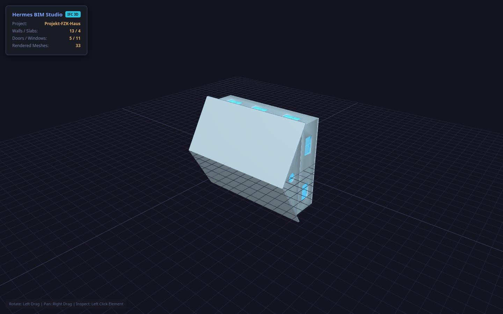

# Hermes BIM Studio

Ask Hermes to read a local IFC file, report wall and slab quantities with their source and coverage, and open the model in an offline 3D viewer.

<!-- DEMO_VIDEO -->



Headless Chrome capture (1440×900) of the HTML page `bim_render_view` wrote for [`samples/sample_house.ifc`](samples/sample_house.ifc).

[](https://github.com/stupidburgers/hermes-bim-studio/actions/workflows/ci.yml)

A Hermes Agent plugin (v0.1.0) for local building-model inspection. It needs Hermes **0.22.0 or newer** and no API key.

## What it does

The plugin registers three tools from [`plugin/`](plugin/):

| Tool | What you get |
| --- | --- |
| `bim_inspect` | Project name, IFC schema, SHA-256, and counts of storeys, spaces, walls, slabs, doors, windows, columns, beams, and roofs. It also reports two model-quality findings: elements among walls, slabs, doors, windows, columns, and beams with no `IfcRelContainedInSpatialStructure`, and walls or slabs with no name. |
| `bim_takeoff` | Wall **net side area** and slab **net volume** from each element's `BaseQuantities`, converted to m² and m³ with that quantity's IFC unit. Doors and windows are entity counts. Every line includes how many elements were measured. Optional caller-supplied rates price those four lines only. |
| `bim_render_view` | A single HTML file with the model geometry and vendored Three.js r128 plus OrbitControls inlined. Orbit, pan, zoom, and click a mesh to see its name, IFC type, and element id. The tool returns a Hermes Desktop `::preview{file="..."}` directive. |

On the bundled fixture, `bim_inspect` reports project **Projekt-FZK-Haus**, schema **IFC4**, 2 storeys, 7 spaces, 13 walls, 4 slabs, 5 doors, 11 windows, 0 columns, 4 beams, 0 roofs, and no findings.

`bim_takeoff` always writes an `.xlsx` workbook with three sheets: **Executive Summary**, **Audit & Provenance**, and **Unavailable Measurements**. `bim_render_view` always writes an `.html` viewer. In this repository the default filenames, placed beside the IFC, are `bim_takeoff_5d.xlsx` and `bim_viewer_3d.html`.

## Install

```bash
hermes plugins install hermes-bim-studio
hermes plugins enable hermes-bim-studio
```

`hermes-bim-studio` is the catalog key in [NousResearch/hermes-agent `plugin-catalog/hermes-bim-studio.yaml`](https://github.com/NousResearch/hermes-agent/blob/main/plugin-catalog/hermes-bim-studio.yaml). That entry points at this repository with `subdir: plugin`, so the installer checks out the **reviewed commit recorded there**, then installs the manifest dependencies `ifcopenshell` (>=0.9.0, <0.10) and `openpyxl` (>=3.1.2, <4) after you accept them.

As of 2026-11-11 the catalog pin is `1eef602bbee93b5893b9cd769d0d8d2b2d9a12a8`. That pin also saves the workbook and the viewer under `<HERMES_HOME>/plugin-data/hermes-bim-studio/` as bare `.xlsx` / `.html` filenames. The tool behavior below was run from this repository's plugin code, whose default is to write beside the IFC and overwrite an existing file at the chosen path.

To install the `plugin/` directory from this repository's default branch:

```bash
hermes plugins install stupidburgers/hermes-bim-studio/plugin
```

## Quick start

With the plugin enabled, paste:

```text
Inspect samples/sample_house.ifc. Report wall and slab quantities with the IFC quantity name and how many elements were measured. Apply these sample USD rates and give the listed-scope total: masonry_wall_m2 = 70, concrete_slab_m3 = 480, door_unit = 250, window_unit = 320. Then open the model in 3D.
```

Those rates are sample inputs so the arithmetic is visible. The fixture declares `IfcMonetaryUnit` EUR. The plugin multiplies by the rates you pass and labels the total USD.

Running the three handlers on that file (Python 3.12.3, ifcopenshell 0.9.0.post1, 2026-11-11) returned:

`bim_inspect`

```json
{
  "project_name": "Projekt-FZK-Haus",
  "schema": "IFC4",
  "file_size_bytes": 2526544,
  "sha256": "ea6f04eaf92fac4d7ad0038bc3d2dfea4c094dd3f516ecc33c50bf1835ca108d",
  "load_time_sec": 0.049,
  "inventory": {
    "storeys": 2,
    "spaces": 7,
    "walls": 13,
    "slabs": 4,
    "doors": 5,
    "windows": 11,
    "columns": 0,
    "beams": 4,
    "roofs": 0
  },
  "findings": []
}
```

`load_time_sec` is from that run.

`bim_takeoff` with the rates above. This is the returned JSON with empty `unavailable` arrays left out. `pricing_status` was `complete_for_listed_scope`. The workbook's Executive Summary showed **$55,058.55**.

```json
{
  "priced_scope_total_usd": 55058.55,
  "line_items": [
    {
      "wbs": "01.01",
      "description": "Slabs — net volume",
      "qty": 76.99159,
      "unit": "m³",
      "source": "BaseQuantities.NetVolume",
      "measured_elements": 4,
      "total_elements": 4,
      "complete": true,
      "rate": 480.0,
      "total": 36955.96
    },
    {
      "wbs": "02.01",
      "description": "Walls — net side area",
      "qty": 190.465524,
      "unit": "m²",
      "source": "BaseQuantities.NetSideArea",
      "measured_elements": 13,
      "total_elements": 13,
      "complete": true,
      "rate": 70.0,
      "total": 13332.59
    },
    {
      "wbs": "03.01",
      "description": "Doors",
      "qty": 5,
      "unit": "units",
      "source": "IFC entity count (IfcDoor)",
      "rate": 250.0,
      "total": 1250.0
    },
    {
      "wbs": "03.02",
      "description": "Windows",
      "qty": 11,
      "unit": "units",
      "source": "IFC entity count (IfcWindow)",
      "rate": 320.0,
      "total": 3520.0
    }
  ]
}
```

Line totals are rounded to cents (76.99159 × 480 = 36,955.96; 190.465524 × 70 = 13,332.59; 5 × 250 = 1,250; 11 × 320 = 3,520). This run wrote a 7,705-byte workbook.

`bim_render_view` with `max_elements` 150 rendered **33** meshes (every wall, slab, door, and window in the file; it has no columns or roofs) and returned:

```text
::preview{file="/tmp/bim-readme/bim_viewer_3d.html"}
```

That page was 900,717 bytes. It contains no `https://cdn.` URL. The screenshot above is that file.

## How it works

1. **Open the file.** `ifcopenshell` reads the path you pass. Inspect records the project name, schema, file size, and SHA-256.
2. **Read named quantities.** For each `IfcWall`, the takeoff looks up a single `BaseQuantities` / `NetSideArea` (`IfcQuantityArea`). For each `IfcSlab`, it looks up `NetVolume` (`IfcQuantityVolume`). The value is multiplied by the IFC unit scale from `ifcopenshell.util.unit`. A missing, ambiguous, empty, non-finite, negative, unitless, or wrong-unit quantity is recorded on the **Unavailable Measurements** sheet and omitted from the sum.
3. **Price only a complete listed scope.** Door and window quantities are `len(IfcDoor)` and `len(IfcWindow)`. A line total is quantity × your rate, and only when that line's coverage is complete. `priced_scope_total_usd` is the sum of the four line totals when every line is complete and has a rate (`masonry_wall_m2`, `concrete_slab_m3`, `door_unit`, `window_unit`). The audit sheet stores the IFC path, SHA-256, schema, sources, and coverage.
4. **Build the viewer locally.** The renderer tessellates up to 60 walls, 30 slabs, 20 doors, 20 windows, 10 columns, and 10 roofs, then stops at `max_elements` (0–150, default 150). Meshes are embedded in HTML with the Three.js r128 files from [`plugin/vendor/`](plugin/vendor/). IFC names are escaped before they are written into the page. Spreadsheet text that begins with `=`, `+`, `-`, or `@` is prefixed so Excel keeps it as text.

The plugin Python reads the IFC path you pass and the vendored viewer scripts. It starts no shell and reads no API key. The viewer scripts are the MIT-licensed upstream r128 files; see [`plugin/vendor/THIRD_PARTY_NOTICES.md`](plugin/vendor/THIRD_PARTY_NOTICES.md).

## Tests

From the repository root, with the same dependency range the manifest declares:

```bash
python3 -m pip install "ifcopenshell>=0.9.0,<0.10" "openpyxl>=3.1.2,<4"
env -u PYTHONPATH python3 -m unittest discover -s tests -v
```

That is the command in [`.github/workflows/ci.yml`](.github/workflows/ci.yml). CI runs it on Ubuntu and Windows for Python 3.11 and 3.12.

A local run on Python 3.12.3 (Ubuntu, ifcopenshell 0.9.0.post1) reported:

```text
Ran 13 tests in 5.280s
OK
```

The 13 tests cover the fixture inspect counts, the fixture takeoff quantities (wall area 190.465524 m², slab volume 76.99159 m³) and workbook wording, a 33-mesh offline viewer, HTML/script escaping, the 0–150 render limit, Excel formula neutralization, unit conversion (square millimetres to m²), a rejected area-unit on slab volume, a withheld total when a rate or a base quantity is missing, and a zero quantity when a category has no elements.

## Limitations

- The priced lines are slabs (`NetVolume`, m³), walls (`NetSideArea`, m²), doors (count), and windows (count). Beams, columns, roofs, spaces, and storeys stay out of the total. On the fixture, the 4 beams are counted by `bim_inspect` and omitted from the takeoff and the viewer.
- Coverage is per element. If any wall or slab lacks a usable base quantity, that line's `total` is empty and `priced_scope_total_usd` is empty, even when the other elements in the line measured successfully. The reported `qty` is then the sum of the elements that did resolve.
- A category with zero elements is quantity 0. It still needs a rate before the four-line total is calculated. With no `rates` argument, every line total and the listed-scope total are empty (`pricing_status`: `not_priced_or_incomplete`).
- Rates have to be finite and zero or positive. There is no default price list.
- The viewer draws a capped subset. A mesh that fails to tessellate is skipped. A click shows that mesh's name, IFC class, and element id.
- In this repository, both report tools always write a file. An existing file at the default path or at the path you pass is overwritten. The workbook and the viewer contain the IFC path, its SHA-256, quantities, element ids, and, in the viewer, mesh geometry.
- The catalog pin named in **Install** keeps those writes under `<HERMES_HOME>/plugin-data/hermes-bim-studio/` and refuses to overwrite silently. Install that pin when you want that behavior.
- CI covers Ubuntu and Windows (Python 3.11 and 3.12). macOS is not in that workflow.

## License

MIT. The bundled Three.js r128 viewer assets are MIT-licensed upstream files; attribution is in [`plugin/vendor/THIRD_PARTY_NOTICES.md`](plugin/vendor/THIRD_PARTY_NOTICES.md).
