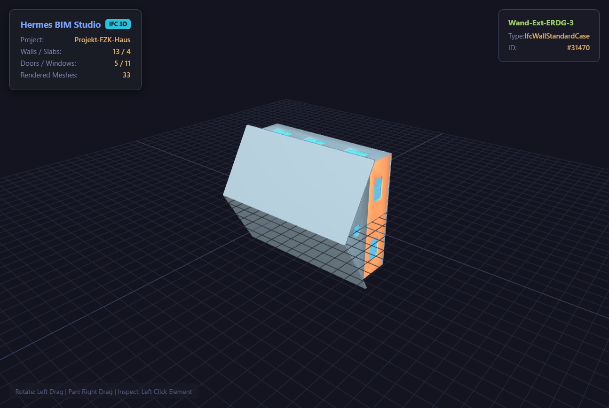

# Hermes BIM Studio

**IFC model inspection, transparent quantity reporting, optional user-priced cost arithmetic, and a self-contained interactive 3D viewer — as Hermes Agent tools.**

Built by [`stupidburgers`](https://github.com/stupidburgers) for the **Hermes Agent Plugin Hackathon** (Nous Research, November 2026).



---

## Why this plugin

IFC models contain structured geometry and quantities that are not directly usable as reliable measurements from natural-language prompting alone. This plugin provides a local parser, a transparent report, and an interactive viewer for a bounded set of IFC data.

Hermes BIM Studio gives Hermes a bounded IFC inspection and quantity-reporting workflow:

| Tool | What it does |
|------|--------------|
| `bim_inspect` | Parses an IFC model and reports project metadata, storeys/spaces, and selected element counts. It flags limited data-quality issues (missing spatial containment, unnamed walls/slabs); it does not certify building-code compliance. |
| `bim_takeoff` | Reports IFC `BaseQuantities.NetSideArea` for walls and `BaseQuantities.NetVolume` for slabs, converted to SI using each quantity's IFC unit. Reports per-element coverage and missing data. Doors/windows are entity counts. Optional caller-supplied USD rates produce a total for these four categories only; this is not a whole-project estimate. |
| `bim_render_view` | Generates a self-contained interactive Three.js viewer (orbit/zoom and click element identity) with vendored scripts, and returns a `::preview{file="..."}` directive for Hermes Desktop. |

## Beyond a prompt or a skill

- **Traceable source quantities.** Reported wall/slab quantities come from named IFC BaseQuantities with unit conversion and per-element coverage; IFC exporter errors remain possible and are surfaced as a data-quality limitation.
- **Scoped pricing only.** Unit rates are caller supplied; a total is explicitly limited to the four supported categories and withheld without complete quantities and rates.
- **Interactive local viewer.** A bundled self-contained Three.js page lets users orbit a model and inspect element IDs/types inside Hermes Desktop preview.
- **No runtime service.** IFC files are processed locally; the viewer does not fetch JavaScript from a CDN or require API credentials.

## Install

```bash
hermes plugins install hermes-bim-studio        # once listed in the catalog
# or directly from the repo:
hermes plugins install stupidburgers/hermes-bim-studio
```

Dependencies (`ifcopenshell`, `openpyxl`) install automatically via the manifest.

## Usage

```
Inspect a building model at `C:/models/office.ifc` and tell me what the IFC contains.
```

```
Report supported IFC quantities for `C:/models/office.ifc` and optionally apply user-supplied USD rates (e.g. `masonry_wall_m2: 70`, `concrete_slab_m3: 480`, `door_unit: 250`, `window_unit: 320`). Any resulting total covers only walls, slabs, doors, and windows—not the whole project—and appears only when each listed item has complete quantities and a supplied rate.
```

```
Show me the building at C:/models/office.ifc in 3D.
```

The 3D viewer HTML is fully self-contained (inline geometry, inlined Three.js runtime) — share it with anyone, no server needed.

## How it works

1. **Semantic parse** — IFC entities and selected project/spatial metadata are read with `ifcopenshell`.
2. **Quantity extraction** — wall `NetSideArea` and slab `NetVolume` are read from `BaseQuantities`; each quantity's explicit or project unit is converted to SI. Missing, malformed, or ambiguous values are reported with element coverage, not estimated.
3. **Optional pricing** — caller-supplied USD rates are multiplied by complete quantities or element counts. The resulting total is for the four listed categories only, never the whole project.
4. **Viewer generation** — selected IFC element meshes are embedded in a self-contained HTML page with vendored Three.js and orbit/click inspection.

## Development

```bash
env -u PYTHONPATH python -m pytest tests/ -q
hermes plugins validate ./plugin --install-deps
hermes plugins doctor ./plugin
```

Multi-platform CI (Ubuntu + Windows, Python 3.11/3.12) runs both unittest modules on every commit: [workflow](../.github/workflows/ci.yml). The Hermes CLI validator is a separate local/catalog check.

## Disclosure

- Reads the IFC path supplied to a tool and the viewer scripts bundled with the plugin.
- Writes a workbook (`bim_takeoff_5d.xlsx`) and/or viewer (`bim_viewer_3d.html`) beside the IFC by default; caller-supplied output paths override these locations. Existing output files at those paths are overwritten.
- Generated files can contain project metadata, the IFC path and SHA-256, quantities, element IDs, and (in the viewer) selected model geometry. Treat them as potentially sensitive project data.
- No network calls, shell commands, background processes, stored credentials, or telemetry.

## License

This plugin is MIT licensed — see repository root. The bundled Three.js r128 viewer assets are also MIT licensed; see `vendor/THIRD_PARTY_NOTICES.md` for attribution and the upstream notice.
